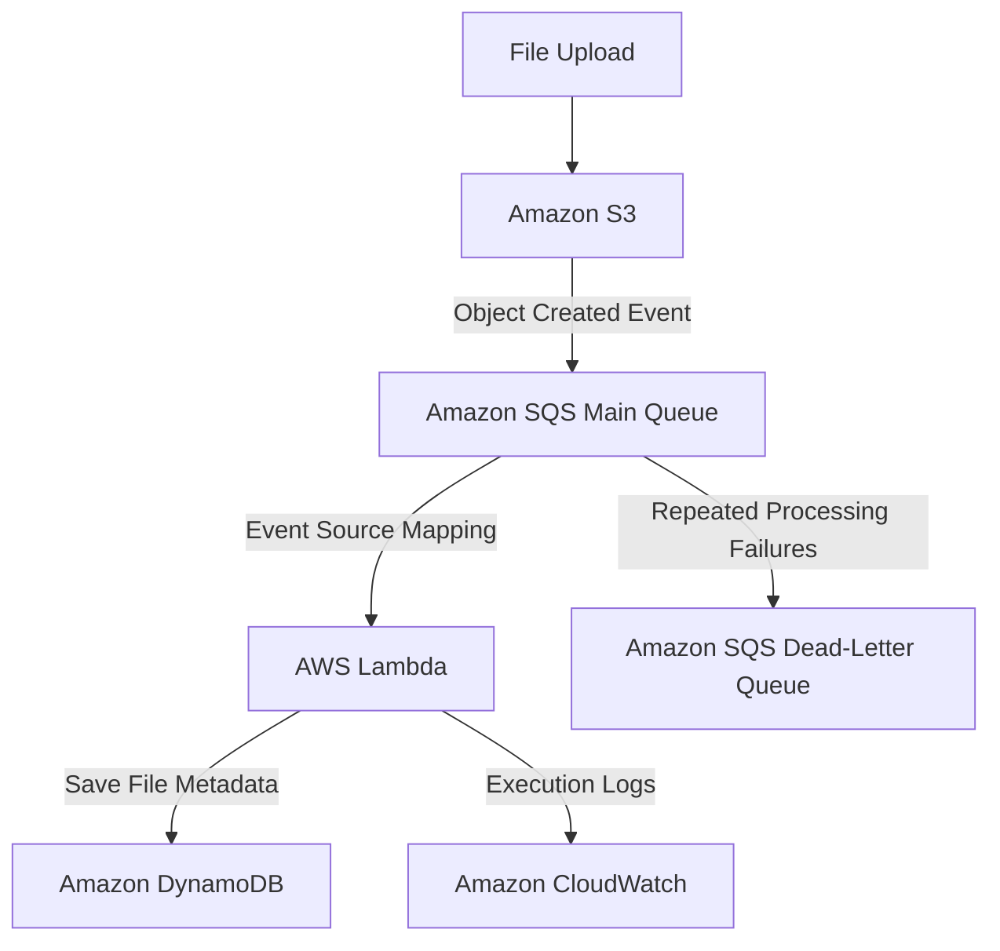

# AWS Serverless File Processing Architecture

## Architecture Diagram

## Component Responsibilities

- **Amazon S3:** Stores uploaded files and emits object-creation events.
- **Amazon SQS Main Queue:** Buffers events and decouples storage from processing.
- **AWS Lambda:** Reads SQS messages and extracts file metadata.
- **Amazon DynamoDB:** Stores the processed file metadata.
- **Amazon SQS Dead-Letter Queue:** Holds messages that exceed the configured retry limit.
- **Amazon CloudWatch:** Captures Lambda logs for monitoring and troubleshooting.

## Event Flow

1. A file is uploaded to S3.
2. S3 sends an event notification to the main SQS queue.
3. Lambda polls SQS through its event source mapping.
4. Lambda extracts the metadata and writes it to DynamoDB.
5. CloudWatch captures execution logs.
6. Messages that repeatedly fail are routed to the DLQ according to the configured redrive policy.

## Deployment Status

This project was deployed and tested in AWS. The project-specific resources have since been deleted to avoid unnecessary ongoing costs. This repository preserves the source code, architecture documentation, and screenshots.
